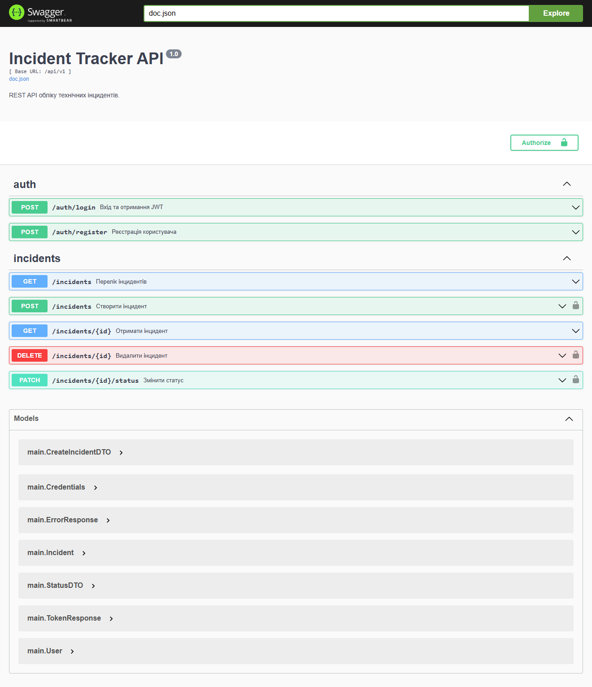
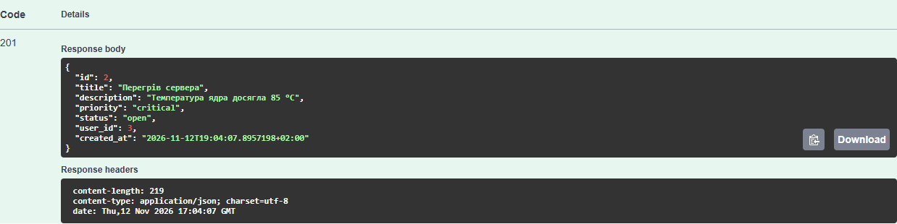

# Практична робота № 5 — Incident Tracker API

REST-сервіс обліку інцидентів: Go, Gin, PostgreSQL, GORM, bcrypt, JWT та Swagger UI. Реалізовано три рівні завдання. Папку можна відкрити у Visual Studio Code через **File → Open Folder**.

## Запуск у Windows без пароля PostgreSQL

Відкрийте `Start-Demo.cmd` подвійним кліком або виконайте в терміналі VS Code з папки проєкту:

```powershell
.\Start-Demo.cmd
```

Скрипт використовує встановлений PostgreSQL 18 і запускає окрему базу для демонстрації на порту 55440. Для цієї бази дозволено підключення з цього комп’ютера без пароля. Папка з даними `.demo-db` виключена з Git. Якщо сервіс уже працює, скрипт покаже посилання. Після появи рядка `Swagger:` відкрийте http://127.0.0.1:8080/swagger/index.html.

## Запуск зі своєю базою PostgreSQL (PowerShell)

Потрібні Go 1.22 або новіше та PostgreSQL; альтернативно базу можна запустити через Docker Desktop. Встановіть розширення Go у VS Code. У терміналі VS Code відкрийте цю папку.

1. Створіть базу `incident_tracker` у локальному PostgreSQL або запустіть `docker compose up -d`. Якщо порт 5432 зайнятий, використайте наявний PostgreSQL і створіть базу в ньому.
2. Налаштуйте адресу своєї бази та секрет для JWT (тут значення для локального прикладу; для реального розгортання задайте унікальний випадковий секрет):

```powershell
$env:DATABASE_URL = 'host=localhost user=postgres password=postgres dbname=incident_tracker port=5432 sslmode=disable'
$env:JWT_SECRET = 'local-development-secret-change-me-123456789'
```

3. У тій самій вкладці термінала виконайте:

```powershell
go run .
```

GORM створить таблиці автоматично. Swagger UI: http://localhost:8080/swagger/index.html. Зупинення сервера — Ctrl+C. Параметр `PORT` дозволяє змінити порт. Для локальної бази змініть пароль у `DATABASE_URL` відповідно до власних налаштувань.

Публічні маршрути: реєстрація, вхід, список і перегляд інциденту за ID. Створення, зміна статусу та видалення потребують токена. Будь-який авторизований користувач може змінювати будь-який інцидент; обмеження за власником у завданні не вимагається.

## Оновлення Swagger з анотацій

У проєкті є згенерована специфікація для Swagger UI у форматах JSON і YAML. Для її автоматичної генерації за коментарями у `main.go` виконайте:

```powershell
go install github.com/swaggo/swag/cmd/swag@v1.16.4
& "$(go env GOPATH)\bin\swag.exe" init -g main.go
go mod tidy
```

## Результати перевірки

Проєкт зібрано й перевірено на Windows з PostgreSQL 18.3. Команди `go build .` і `go vet ./...` пройшли. Сценарій виконав 20 HTTP-перевірок, зокрема реєстрацію, вхід, відхилення недійсного токена, валідацію пріоритету й статусу та повний цикл інциденту. Окремо перевірено збереження гешів bcrypt у PostgreSQL і авторизоване створення інциденту через Swagger у Chrome.

Щоб повторити HTTP-перевірки, запустіть сервіс із тестовою базою і виконайте в PowerShell 7:

```powershell
./smoke-test.ps1
```

Сценарій створює тестовий обліковий запис та видаляє створений інцидент наприкінці перевірки. Для іншого порту передайте `-BaseUrl`.





